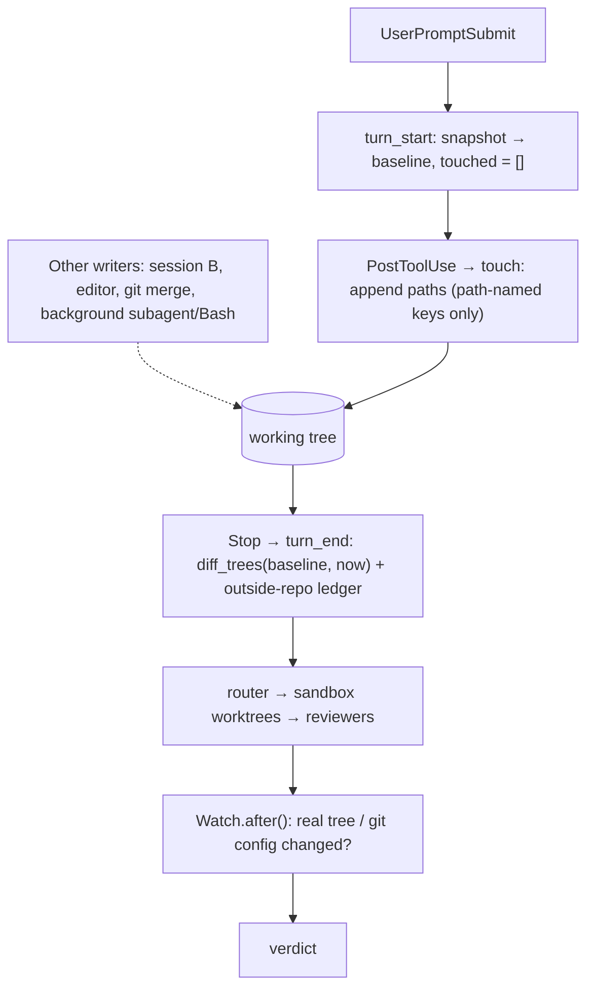
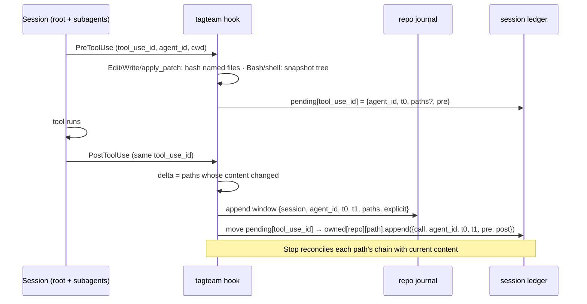

# Attribution redesign: own changes per tool call

Status: Phase D (Claude cutover) implemented 2026-11-25. Phase E (other harnesses, recovery, reuse) not started.

### As built, and where it differs from this proposal

- **Per file, not per hunk.** A file is own when this session's spans chain unbroken from the review
  baseline's blob to the reviewed blob. Any break makes the whole file a suggestion; own hunks inside a
  mixed file don't block. Revisit when `shadow.jsonl` shows mixed files are common.
- **Started early.** The cutover shipped after one day of shadow data (3 Stops, 0 foreign, 0 overlaps)
  instead of a week, at the user's request. `shadow.jsonl` keeps logging every Stop, with a `fallback` flag.
- **The baseline is kept only for own work.** `turn_start` keeps the old baseline when the session's ledger
  holds calls since it, or after a stopped or timed-out review (`hold`). An editor edit between turns with
  no own work is not reviewed, as before; a git pull between idle turns would otherwise become a large
  unattributed review. A Stop that skips by choice (trivial change, untriggered kind) advances it.
- **Fallback to "all own"** when the ledger can't vouch: a skipped Bash snapshot in the window, a PostToolUse
  with no PreToolUse (hooks older than the package), any ledger error, `[ledger] attribute = false`, or a
  non-Claude author.
- **Contested overlaps across sessions** are not resolved: any call by another session that changed the path
  in the window makes it foreign, even when that write landed inside one of this session's Bash calls. The
  "Edit beats a snapshot" rule is not built, so a path both sessions claim is a suggestion for both.
- **F3** worktree deltas are diffed from the first call's `pre` blob (written with `hash-object -w`) to the
  current file, and labelled with the same chain rule.
- Own calls pruned after 24 h leave their change unattributed.

## Problem

tagteam reviews everything that changed in the working tree between `turn_start` and Stop
(`diff_trees(baseline, now)`) as the session's own work. That over-counts whenever anything else
writes to the tree, and under-counts whenever the window resets before a Stop runs.

### Current pipeline



### Failures (reproduced against `collect` / `turn_start`)

Silent losses rank above noisy errors: a missed review is worse than a loud false positive.

| # | Failure | Repro | Kind |
|---|---|---|---|
| F2 | Writes between Stop and the next prompt are never reviewed. That covers background subagents, background Bash, interrupts (Esc fires no Stop), crashes, and hook timeouts. `turn_start` re-baselines and clears `touched` (`core.py:53`). The `<task-notification>` turn that reports a finished background subagent runs `turn_start` like any prompt, so the subagent's writes are already in its baseline. | Live Claude capture: the root stops with the subagent still running, the subagent writes `bg.txt` 20 s later, and the notification turn's baseline already contains `bg.txt` | silent loss |
| F2b | A background review that finishes after the next turn has started is discarded ("new turn started during review; session state not updated"). A `<task-notification>` turn arriving moments after Stop is enough to trigger it. | Live Claude capture, first run | lost result |
| F3 | Writes by an `isolation: worktree` subagent are dropped, because its in-repo worktree is excluded as a nested repo (`changes.py:47`). | Live Claude capture: reviewed `bg fg p1 p2 root`, not `wt.txt` | silent loss |
| F6 | Copilot and agy run each subagent as its own session (its own `sessionId` / `conversationId`, its own turn start and Stop). tagteam reviews the subagent at its own Stop and the root reviews the same change again. A blocking finding would start a fix loop inside the subagent. | Live Copilot capture: `sub2.py` reviewed by two runs, one per session. agy: two session files for one prompt | double review |
| F5 | agy reads only `workspacePaths[0]` (`agy.py:17`). | code read | silent loss |
| F1a | Two sessions in one tree each review both sessions' work. B can be blocked on A's in-flight code. Digest memory is per session, so the same lines are paid for twice. | A and B both see `a.py, b.py` | misattribution |
| F1b | A merge, pull, or checkout during a turn is reviewed as code the session wrote. | merge only → diff `up.py` | misattribution |
| F1c | Your own editor edits during a turn are blamed on the agent. | same mechanism as F1a | misattribution |
| F4 | A git config or hook change by another session during A's review disables every reviewer of A's run (`core.py:289`). Without a sandbox, any concurrent tree edit does the same (`core.py:288`). | `core.hooksPath` → disable signal | false disable |

The repros skip the `min_changed_lines` and trigger gates. That doesn't change any of the findings.

## Proposal

A session owns a path only when one of its own tool calls changed that path. Every write-capable
tool call is bracketed by a before and an after reading. Writes that land between calls belong to
someone else.



### Data model

```
session ledger   owned[repo_root][path] = [{call, agent_id, t0, t1, pre: blob|null, post: blob|null}, …]
                 kept until a verdict covers it (no re-baseline at turn_start)
pending calls    pending[tool_use_id] = {agent_id, t0, cwd, paths (if named), pre: file blobs | tree id}
                 written at PreToolUse, before the tool runs; removed at PostToolUse or by recovery
open jobs        jobs[shell_id] = {session, agent_id, t0, cwd}
repo journal     windows.jsonl: {session, agent_id, t0, t1, paths, explicit}
reviewed ledger  (repo, path, base_blob, final_blob) → {run_id, findings with line ranges, hunks covered}
```

### Safety net: the ledger decides blocking, never coverage

Stop still takes today's whole-tree diff (`turn_baseline → now`). The ledger only decides which hunks
are the session's own and can block. Every hunk in the tree diff that no ledger claims, from this or
another live session, is reviewed as an *unattributed* suggestion. So the ledger can mislabel a change
but can never drop one. Coverage is never worse than today, in any phase. Abandoned-call recovery,
background-job records, and orphan handling only improve the labels: they turn "unattributed" into
"uncertain, probably from call or job X".

The baseline for this net still has to survive missed Stops. `turn_start` keeps the oldest unreviewed
baseline instead of replacing it (F2). Changes made between turns, such as editor edits, then fall
into the net as unattributed suggestions instead of being silently skipped.

### Reconciling a path at Stop

1. **Merge the session's overlapping calls into spans.** Parallel tool calls and sibling subagents in
   one session can edit the same file at once, so their before and after content interleave. Merge
   every group of this session's calls on the path that overlap in time into one span. A span's
   `pre` is its earliest call's `pre`, and its `post` is its latest call's `post`. Without this step,
   a sibling's edit looks foreign and the session's own defects are downgraded to suggestions. A write
   by another session that falls inside a span is handled as a contested overlap (below), not as a
   gap.
2. **Check the chain across spans.**
   - **Unbroken:** each span's `pre` equals the previous span's `post`, and the current content equals
      the last `post`. Every change since the first `pre` is the session's own, and normal review
      applies, blocking included.
   - **Broken:** a gap between spans, or a change after the last span, is a foreign edit. Reviewers
      still see the whole-file diff for context. The session's own hunks (each span's `pre → post`) are
      marked as its own, and gap hunks as foreign. Only findings on the session's own lines can block.
   - **Ambiguous:** a foreign hunk overlaps or touches one of the session's own hunks. Every finding
      in that region is a suggestion, and the notice says the file had more than one writer.
3. **Contested overlaps across sessions.** If another session's window overlaps this one on the
   same path, the path is contested. A claim where Edit or Write named the path beats a claim inferred
   from a snapshot. A claim still contested is a suggestion for both sessions.

Test cases to include: two sessions writing sequentially to one file; sibling subagents of one
session writing in parallel to one file; an editor edit between two calls; an editor edit inside a
Bash window; a tool that writes a file whose PostToolUse never arrives, followed by the next prompt
(the file must surface as an uncertain suggestion); an interrupted Bash write to one function
followed by another session's edit to a different function in the same file (the first edit must
stay an uncertain suggestion for the interrupted session, and the second must belong to the other
session).

### Calls that never finish

An interrupt (Esc), a crash, or a timed-out PostToolUse hook leaves a call with a `pending` entry and
no `post`. Writes the tool made are on disk but in nobody's ledger.

- **When a call counts as abandoned.** A pending call is abandoned when a later event shows the call
  can no longer be running:
  - the same session's next `turn_start` (an interrupt ends the turn without a Stop);
  - a resumed session's first hook;
  - a Stop of the root agent while the call belongs to the root agent rather than a background subagent
    (Stop fires only after the root's own tool calls finish).

  A pending call of a background subagent stays pending; its own later events close it.
- **Recovery.** For an abandoned call, compare its `pre` with current content:
  - For a call that named its files (Edit, Write, apply_patch), use those files.
  - For a Bash call, use the tree snapshot.
  - Bound the call per path. Its end state is the earliest later call's `pre` on that path, from any
    session, or the current content if no later call touched it. The abandoned delta is `pre` → that
    end state. Both sides are real snapshots, so no hunks are subtracted across different bases.
  - The delta is owned by the session as an *uncertain* change: it is reviewed, and its findings are
    suggestions.
  - Writes after that bound, such as from a process the interrupted tool left running, aren't this
    call's. The safety net (below) catches them as unattributed, so nothing is dropped.
  - Example: an interrupted Bash call changes function A, then another session's Edit changes function
    B in the same file. The Edit's `pre` contains A but not B, so the abandoned delta is A alone. A is
    an uncertain suggestion for this session, and B belongs to the other session.
- **No later event at all** (the session crashed and never comes back): the pending entry becomes an
  orphan. At the next Stop of any session in the repo, its delta shows as unattributed suggestions,
  the same as a subagent session with no parent link.
- Limitation: work from an interrupted call is recovered, but only as suggestions. A write that lands
  after the interrupt but before recovery, by a child process the tool left running, is
  indistinguishable from a foreign write.

### Background shell jobs

A Bash call can start a process that writes after the call returns. No hook fires for those writes.

- **Jobs tagteam can see** (Claude `run_in_background`, which returns a shell id): tagteam records an
  open job. Any write that no call claims while the job is open is tagged "probably from job X" and
  is a suggestion. The job closes on the `<task-notification>` turn, or on a BashOutput or KillShell
  call for that id.
- **Jobs tagteam can't see** (`cmd &`, `nohup`, daemons): their writes surface at the next Stop as
  unattributed suggestions. They never block and are never dropped.
- Limitation: tagteam never reviews background Bash work with blocking as the session's own.

### Reusing another session's review

- **Key on the change itself:** the content before and after. The same final content reached from a
  different base is a different change.
- **Cache findings, not verdicts.** The ledger stores findings with their line ranges and which hunks
  the review covered. It never stores a "passed" or "advisory" result.
- **Re-gate for the session asking.** When B reuses A's findings, B applies its own ownership. A
  finding on B's own lines can block B even if it was only a suggestion for A. An advisory review
  never stands in for a passed blocking review.
- **Coverage must match.** If any hunk B owns wasn't in the cached review, that path is reviewed again.

### Effect on each failure

| Case | New behaviour | Status |
|---|---|---|
| F1a two sessions | Each session owns only its own calls. Sequential edits by another writer break the chain and become foreign hunks; overlapping windows are contested. | fixed; same-file overlaps are suggestions |
| F1a double review | Findings are reused by delta and re-gated per session. | fixed |
| F1b merge | A merge you run yourself owns nothing. A Bash call whose delta comes from a ref move is classed as *integrated*. A cached delta reuses its findings; the rest are suggestions. | fixed |
| F1c editor | Writes between calls are unattributed and never block. | fixed; same-file overlaps are suggestions |
| F2 missed Stop, background subagent | Calls that completed stay in the ledger until a verdict covers them. A background subagent's writes come from its own tool calls. | fixed |
| F2 interrupt, crash, hook timeout | A call without PostToolUse is recovered from its pending entry once it's abandoned. See "Calls that never finish". | partial: suggestions only |
| F2 background Bash | See "Background shell jobs". | partial: suggestions only |
| F3 worktree | Deltas are keyed by `repo_root(tool cwd)`. A worktree subagent's payload `cwd` is the worktree, and its Write `file_path` is absolute inside it (captured). | fixed |
| F6 split subagent sessions | A session whose first event names a parent (Copilot `parentAgentId`) is not a session of its own: its calls go to the root's ledger and its Stop reviews nothing. agy sends no parent field. Its parent's transcript (`transcriptPath`) records `Created the following subagent: {"conversationId": …}`, so at the child's Stop tagteam looks for its ID in the transcripts of the workspace's other live agy sessions. Only a found ID suppresses the child's review. When none is found, or more than one matches, the child is reviewed as today: a double review, never a miss. | fixed for Copilot; agy depends on its transcript format, falls back to today |
| F2b late background result | Results are keyed by the deltas they reviewed, not the turn. A result that lands after a new turn started still closes those deltas. | fixed |
| F4 disable | A reviewer is blamed only for writes in its own sandbox. A shared git config or hook change stops the run with no verdict and no disable, and the change is reviewed again next turn. Other real-tree changes produce a warning. | fixed (shipped before the ledger) |
| Residual | A foreign write inside this session's Bash window is still claimed unless the writer named the path explicitly. | narrowed to one tool call |

## Scaling

`changes.snapshot()`, median of 7 runs:

| Repo | Tracked files | Median | Max |
|---|---|---|---|
| tagteam | ~100 | 30 ms | 36 ms |
| page-rank | 9,812 | 53 ms | 86 ms |
| synthetic | 100,000 | 294 ms | 324 ms |
| synthetic + fsmonitor, untrackedCache | 100,000 | 368 ms | 488 ms |

Real large repo (2026-11-24): a shallow clone of the Linux kernel, 97,373 tracked files. Each figure is
one whole hook process (Python start, import, `snapshot`), median of 7 runs:

| Tree state | Median | Max |
|---|---|---|
| clean | 559–735 ms | 739 ms |
| 50 modified + 200 untracked files | 582–764 ms | 828 ms |
| same + one 50 MB untracked file (not ignored) | 746 ms | 1,514 ms |

The range covers two runs, the slower one taken while another agent was running. Per snapshot:
`add -A` ≈ 300 ms, `ls-files -o` (the nested-repo scan) ≈ 145 ms, `write-tree` ≈ 25 ms. The rest
is the process itself and copying the 10 MB index. Plain `git status` takes 270 ms. Bare Python
startup is 16 ms. fsmonitor doesn't help, because each snapshot uses a copied temp index. An
untracked file is never in the real index, so every snapshot hashes it again.

- **Per call:** Edit, Write, and apply_patch hash only the files they name (about 1 ms). Only Bash and
  shell calls take two tree snapshots: about 0.1 s at 10k files and **1.1–1.5 s at 100k files**.
  Read-only tools aren't hooked.
- **Cheap wins before a watcher:** fold the nested-repo scan into the `add -A` pass (≈ 145 ms per
  snapshot at 100k), and reuse a Bash call's Post snapshot as the next Bash call's Pre when
  no other writer touched the tree in between (the next call's Pre would otherwise re-scan the same tree).
- **N sessions:** cost is linear, and nothing is serialized across the machine. Each session writes its
  own ledger file. Journal appends take a short per-repo lock. Git's object store handles concurrent
  writers.
- **Pairing calls:** every captured harness sends the same call ID on Pre and Post. Claude sends
  `tool_use_id`, Copilot `toolCallId`, agy `toolCall.id` (plus `stepIdx`), and OpenCode `callID`.
  Codex also sends `tool_use_id`. A harness without PreToolUse falls back to using the previous Post as the
  next Pre, and is labelled approximate.
- **Costs to watch:** snapshots store blobs for dirty files. Large untracked files that get rewritten
  over and over make `.git/objects` grow until gc prunes them.
- **Above about 50k files:** add a per-repo watcher (FSEvents or inotify) that feeds dirty paths. Don't
  skip Bash commands that only look read-only: a wrong guess means a silent miss.

## Subagent policy

**The root session owns its subagents' work. The review runs at the root's Stop, not at
SubagentStop.** A subagent is a tool of the parent: the parent asked for the work, integrates it, and
is the one talking to the user. Reviewing each subagent at SubagentStop goes wrong in four ways:

- Cost multiplies with fan-out, which runs into the hourly cap and the per-session lock.
- Much subagent output is intermediate, and the parent may rewrite it or throw it away.
- The fix loop would run where neither the user nor the parent can see it.
- Blocking a subagent stalls the parent.

| Case | Rule | Today |
|---|---|---|
| Foreground subagent | Calls carry the root `session_id` plus `agent_id`. Deltas go to the root ledger, tagged by agent. Findings name the subagent that wrote the code. | Claude: works by accident |
| Parallel subagents | Same owner, so their windows merge into spans (see reconciliation step 1). | Claude: works by accident |
| Running at the root's Stop | Review only closed calls. Open windows roll over to the `<task-notification>` turn's Stop. The root's Stop payload lists running subagents in `background_tasks`, which marks the open window. | lost (F2, captured) |
| Worktree subagent | Deltas are keyed by the worktree root and reviewed as their own group from a sandbox of the worktree's snapshot. A later merge reuses the findings when the before and after content match. | lost (F3, captured) |
| Nested subagents | Walk up to the root. OpenCode already does this (`opencode-plugin.js:50`). | OpenCode only |
| Subagent as its own session (Copilot, agy) | Fold it into the root: its calls go to the root ledger, its turn start takes no baseline, and its Stop reviews nothing. Copilot names the parent (`parentAgentId`). agy doesn't, so link through the parent's transcript, with today's review as the fallback (see F6). | reviewed twice (F6, captured) |
| Subagent session with no parent link | Its ledger never sees a user turn. Surface its deltas at the next Stop of any session in the repo as unattributed suggestions. | none seen: Codex, like Claude, keeps subagents in the root session |

### Hook payloads (captured 2026-11-24)

Live headless runs with logging hooks next to tagteam's own. The sanitized captures are in
`tests/fixtures/subagents/`.

| | Claude 2.x | Copilot 1.0.114 | agy 1.5.16 | Codex 0.172 |
|---|---|---|---|---|
| Subagent identity | same `session_id` as the root; `agent_id` + `agent_type` on every subagent event | own `sessionId` = `agentId`; `parentAgentId` = root `sessionId` | own `conversationId`; no parent field anywhere in the payload | same `session_id` and `turn_id` as the root; `agent_id` + `agent_type` on subagent events |
| Subagent lifecycle events | `SubagentStart`/`SubagentStop` (root `session_id`, `agent_id`) | `subagentStart`/`subagentStop` on the root, plus the subagent's own `userPromptSubmitted` and `agentStop` | the subagent's own `PreInvocation` (invocationNum 0) and `Stop` | `SubagentStart`/`SubagentStop` with `agent_id` |
| Call ID on Pre and Post | `tool_use_id` | `toolCallId` | `toolCall.id`, `stepIdx` | `tool_use_id` |
| Launching call → subagent | Agent Post `tool_response.agentId` (foreground and background) | Pre/Post of the `task` tool bracket the subagent | none in the payload. `invoke_subagent` is asynchronous: its Post (`t=…860.405`) comes *before* the subagent's first `PreInvocation` (`…860.419`). The link is in the parent's transcript: `Created the following subagent: {"conversationId": …}` | `collaboration.spawn_agent` Post returns before `SubagentStart` (asynchronous); `wait_agent` joins it |
| Worktree subagent `cwd` | the worktree path | — | default `workspace: "inherit"` = parent's tree | not captured |
| Background | Agent Post returns at once (`isAsync`); root Stop lists `background_tasks`; a `<task-notification>` prompt + Stop follow | not captured | every agy subagent is asynchronous (see above); a long-running one was not captured | every spawn is asynchronous; the root's `wait_agent` held it inside the turn |
| PreToolUse reply | `{}` allows | `{}` allows | `{}` **denies**; must reply `{"decision": "allow"}` | `{}` allows |

Claude also produced a same-session overlap worth keeping as a fixture: the root's `until [ -f bg.txt ]`
Bash ran inside the background subagent's Bash window.

## Workarounds and heuristics in the code today

- `claude_shaped_owner` guesses which agent sent a payload: a string `timestamp` means Copilot, and
  `turn_id` without `prompt_id` means Codex (`claude.py:17-22`).
- `intent()` uses regexes to strip harness XML and detect non-user prompts (`core.py:29-31`).
- `swap_root` rewrites sandbox paths in findings with a regex (`core.py:114`).
- A Copilot no-hooks settings file is injected into every sandbox.
- `Watch` catches reviewer writes after the fact instead of preventing them.
- Digest memory, the hourly reservation, and the two-failures breaker guard against loops and runaway
  cost.
- Quota is read from a status-line tee, Codex rollout files, and stderr regexes.
- ~~A confirm round keeps only suggestion-level issues open.~~ Fixed in #7: `verdict.demote` carries
  its findings forward as suggestions.

## Before building

1. ~~Capture subagent hook payloads for each harness.~~ Done for Claude, Copilot, agy, and Codex. See "Hook
   payloads".
2. Prototype the ledger behind a flag next to today's diff, and log where the two disagree on real
   work for a week.
3. Add a `tagteam doctor` warning when two live sessions share one working tree. The clean fix is a
   worktree per session, which tagteam can recommend but not enforce.
